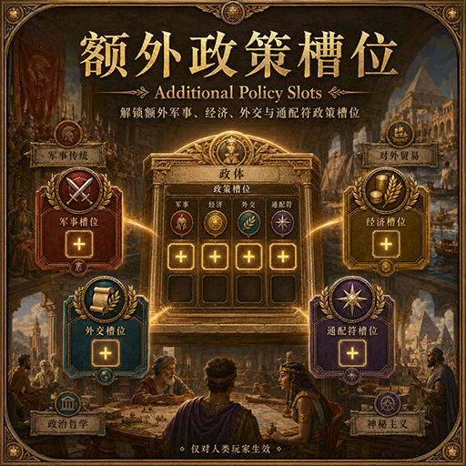
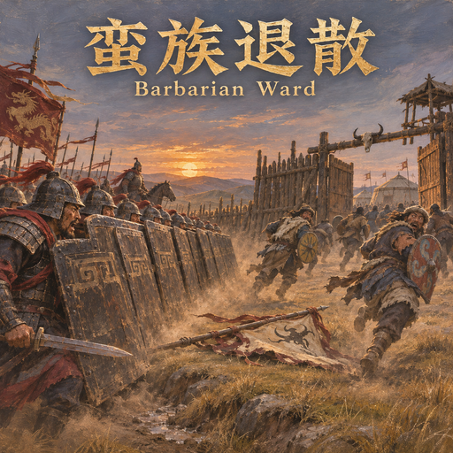
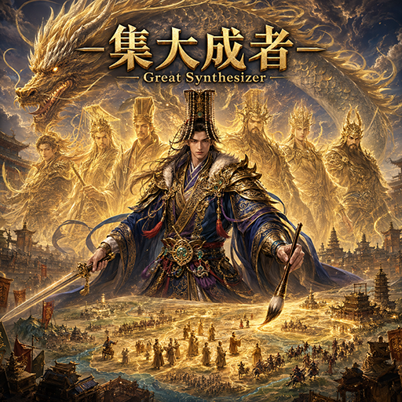
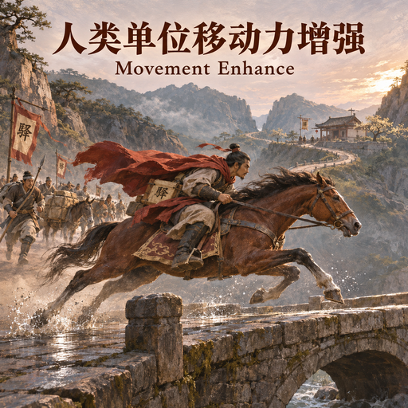
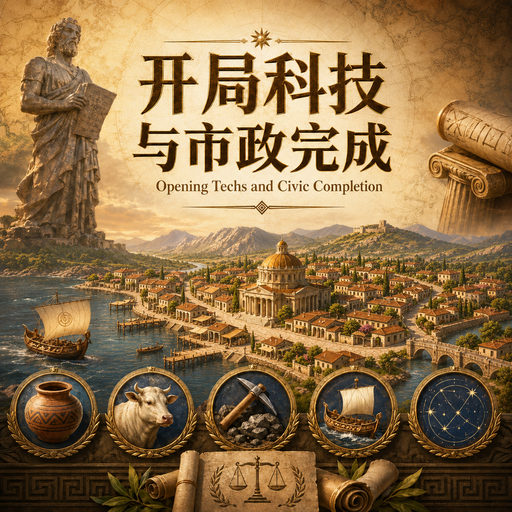
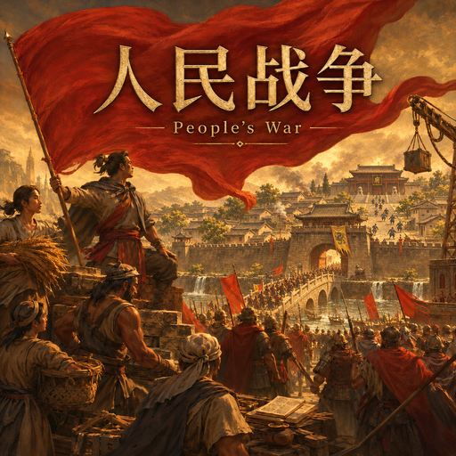
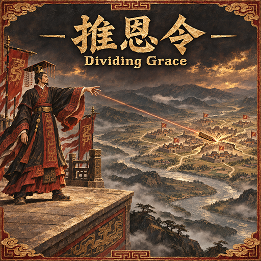
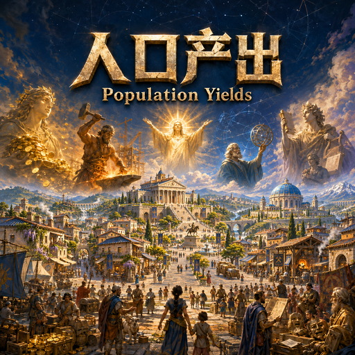
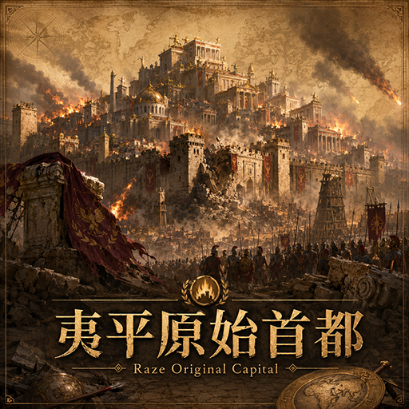
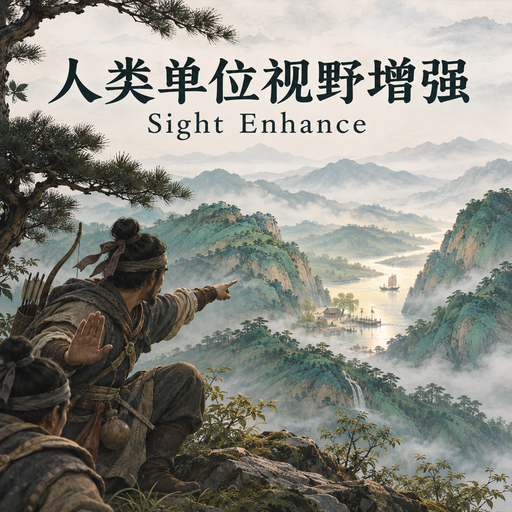

# Civilization VI Mods

## Repository Introduction

This repository collects the [Civilization VI](https://civilization.2k.com/civ-vi/) mods I implemented. These mods can be downloaded from [Steam Workshop](https://steamcommunity.com/app/289070/workshop/), or you can clone this repository and place the mod folders you need into the corresponding Civilization VI mod folder.

The local mod folder is usually located at `%USERNAME%\Documents\My Games\Sid Meier's Civilization VI\Mods`.

## Mod Descriptions

### Additional Policy Slots

Folder: `AdditionalPolicySlots`

Provides additional policy slots for human players after they have the corresponding civics:

- Having the "Military Tradition" civic: +1 Military Policy Slot.
- Having the "Foreign Trade" civic: +1 Economic Policy Slot.
- Having the "Political Philosophy" civic: +1 Diplomatic Policy Slot.
- Having the "Mysticism" civic: +1 Wildcard Policy Slot.

AI players are not affected.

### Barbarian Ward

Folder: `BarbarianWard`

Human combat units gain a 99 advantage when combating barbarian units.

### Great Synthesizer

Folder: `GreatSynthesizer`

Under the Gathering Storm ruleset, all leaders of the same major civilization share the non-internal leader traits of the other leaders of that civilization.

- Leaders added to the Gameplay DB by enabled DLC and community mods are included.
- The Leader Pool exclusions are not read.

### Hegemony Victory

Folder: `HegemonyVictory`

An independent victory for Gathering Storm games without teams. The option is checked by default in Advanced Setup and can be toggled separately from Score Victory. It supports single-player, online multiplayer, and hot seat. When enabled, progress appears in the World Rankings overview and the Hegemony Victory tab. Civilizations are sorted by how many of the ten requirements they meet, highest first.

The game checks at the start of each global turn and after each city conquest. Human and AI major civilizations win when they meet all the following requirements at once. Rivals include every other living major civilization, including unmet civilizations.

- Score must strictly exceed the highest rival score.
- Food, Production, Science, Culture, Faith, and net Gold per turn, along with military strength, must each strictly exceed the corresponding rival total. Net Gold deducts maintenance and counts a rival's zero or negative net income as zero. Military strength uses current units' strength and remaining health, rounded down after summing each civilization's units. Treasury Gold is excluded.
- Own more than half the completed world wonders still on the map and be suzerain of more than half the living city-states that have a suzerain. Each requirement is automatic when its corresponding world total is zero.

The base game handles victory when only one major civilization remains.

### Movement Enhance

Folder: `MovementEnhance`

This mod grants a global movement bonus to all units controlled by human players. Once enabled, every unit owned by a human player receives 1 Movement. AI players are not affected.

### Opening Techs and Civic Completion

Folder: `OpeningTechsAndCivicCompletion`

In Ancient Era starts, when a human major player's first turn starts after entering the game, the following opening technologies and civic are immediately completed:

- Technologies: Pottery, Animal Husbandry, Mining, Sailing, Astrology.
- Civic: Code of Laws.

This effect triggers only once and does not affect AI players. This effect does not trigger in non-Ancient Era starts.

### People's War

Folder: `PeoplesWar`

This mod applies to human and AI major civilizations and city-states under the Gathering Storm ruleset.

- Normal and religious combat strength increase with total empire population: +1 at 1–10 population, +2 at 11–20, and so on, capped at +100.
- Each city gains +1 ranged strike and +1 outer defense at 2 population and every 2 population thereafter, capped at +50 each at 100 population.
- Each city gains 1 counter-spy level per 5 population, starting at 1 population. The bonus is +1 at 1–5 population, +2 at 6–10, and capped at +20 at 96 population.
- Conquered cities lose no population.

### Dividing Grace

Folder: `DividingGrace`

Under the Gathering Storm ruleset, human major civilizations can select the Dividing Grace project in the city production queue.

- On completion, if the city can be razed and another kept city can receive its population, the city is removed and its population is divided equally among the civilization’s other kept cities. Remainders go to the least populous cities first.
- If the project cannot take effect, the city remains and recovers half of the project cost, rounded down, when it starts its next production.

### Population Yields

Folder: `PopulationYields`

Under the Rise and Fall and Gathering Storm rulesets, each city gains +2 Gold, +0.5 Production, +1 Faith, +0.5 Science, and +0.5 Culture per population.

This effect applies only to human major players. AI players do not receive these effects.

### Raze Original Capital

Folder: `RazeOriginalCapital`

By modifying the global configuration, any city can be razed, affecting both human players and AI.

### Sight Enhance

Folder: `SightEnhance`

This mod provides a global sight range bonus to human player units. All units controlled by human players will gain an additional 1 point of vision. It can stack with João III's Porta do Cerco. This effect does not affect AI players.

### Better Rock Band Lens

Corresponding folder: `BetterRockBandLens`

Co-developed with Steam user [BAZINGA1990](https://steamcommunity.com/profiles/76561198144612613/).

When a rock band is selected, the increase in performance level gained in the region is displayed based on that band's skills.

## License

This repository is licensed under the [Apache License 2.0](LICENSE.txt).
