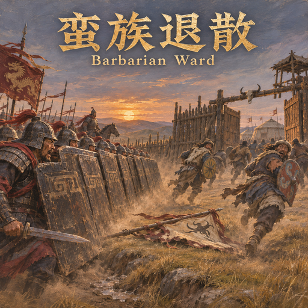
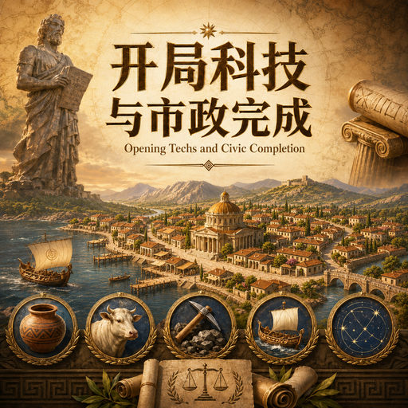
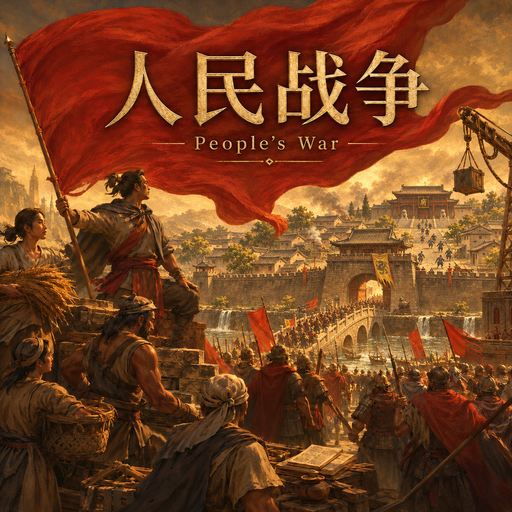
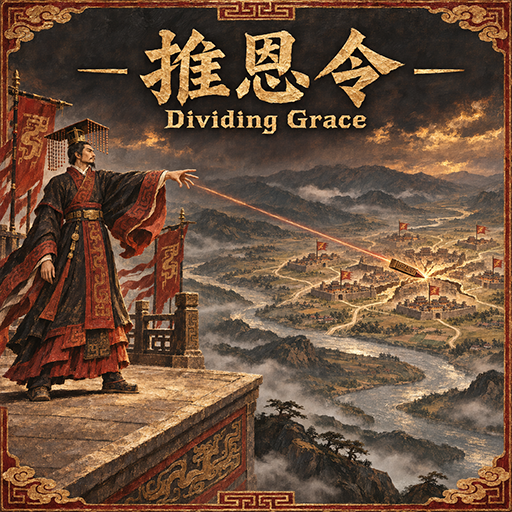
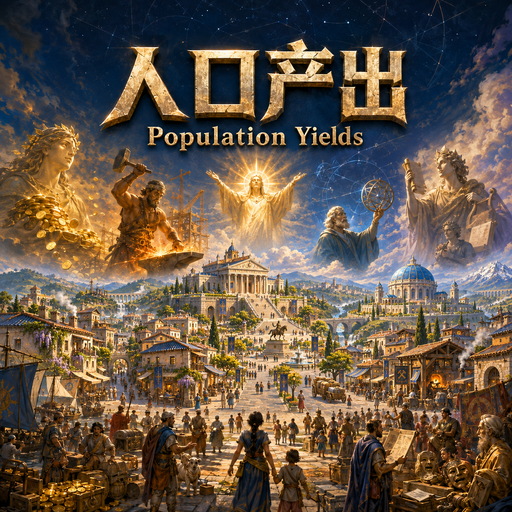
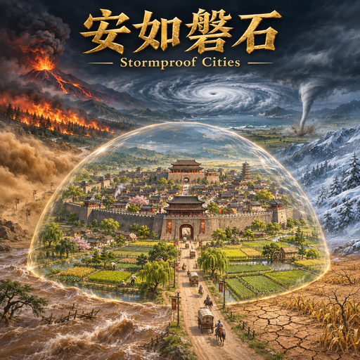

# 文明 VI Mods

[English](README.en.md)

## 仓库介绍

该仓库收集我实现的 [文明 VI](https://civilization.2k.com/civ-vi/) mod。这些 mod 可在 [Steam 创意工坊](https://steamcommunity.com/app/289070/workshop/)下载，也可自行 clone 本仓库后，将需要的 mod 文件夹放到对应的《文明 VI》mod 文件夹下使用。

本地 mod 文件夹一般为 `%USERNAME%\Documents\My Games\Sid Meier's Civilization VI\Mods` 。

维护者可使用[创意工坊发布工具](tools/workshop/README.md)导入、核对和发布条目。

## 各 mod 介绍

### 额外政策槽位

对应文件夹：`AdditionalPolicySlots`

人类玩家拥有对应市政后，提供额外政策槽位：

- 拥有「军事传统」市政：加一军事政策槽位。
- 拥有「对外贸易」市政：加一经济政策槽位。
- 拥有「政治哲学」市政：加一外交政策槽位。
- 拥有「神秘主义」市政：加一通配符政策槽位。

该效果不会影响 AI 玩家。

### 蛮族退散

对应文件夹：`BarbarianWard`

人类战斗单位与蛮族单位战斗时获得 99 战斗力增益。

### 集大成者

对应文件夹：`GreatSynthesizer`

同一主要文明的所有领袖共享该文明其他领袖的非内部领袖能力。

- 当前启用的 DLC 和社区 Mod 中已写入 Gameplay DB 的领袖也会参与。
- 本 Mod 不读取 Leader Pool 排除设置。

### 霸权胜利

对应文件夹：`HegemonyVictory`

霸权胜利适用于非组队对局，在高级设置中默认开启，可单独切换。启用后，世界排名「总体」中的「霸权胜利」卡片显示当前领先的文明。在「霸权」页签中，将鼠标悬停在本方的任一指标上，可查看该项的达标条件。

要取得霸权胜利，您的文明必须同时满足以下条件。

- 每回合的食物、生产力、科技、文化、信仰和净金币，以及军力，分别超过所有存活对手的相应合计。比较净金币时，只计入对手的正净收入。
- 您拥有的已完工且仍存在的世界奇观数量，以及您担任宗主的存活城邦数量，均不少于所有存活对手的相应合计。

### 人类单位移动力增强

对应文件夹：`MovementEnhance`

本 mod 为人类玩家提供全局单位移动力加成。启用后，所有由人类玩家控制的单位将额外获得 1 点移动力。该效果不会影响 AI 玩家。

### 开局科技与市政完成

对应文件夹：`OpeningTechsAndCivicCompletion`

适用于从远古时代开始的对局。启用本 mod 后，每位人类玩家（限主要文明）在自己的首个回合开始时，补完下列尚未完成的科技和市政。

- 科技：制陶术、畜牧业、采矿、航海术、占星术。
- 市政：法典。

每位符合条件的玩家只会获得一次补完效果。读取旧档前也可以启用本 mod。

### 人民战争

对应文件夹：`PeoplesWar`

仅在“风云变幻”规则集下生效，适用于人类主要文明、AI 主要文明和城邦。

- 根据帝国总人口提高普通与宗教战斗力：总人口 1–10 时为 +1，11–20 时为 +2，以此类推，最高为 +100。
- 每座城市每满 2 人口获得 +1 远程攻击和 +1 外防御，100 人口时各封顶 +50。
- 每座城市从 1 人口起每 5 人口增加 1 级反间谍。1–5 人口为 +1 级，6–10 人口为 +2 级，96 人口时封顶 +20 级。
- 征服城市时不会损失人口。

### 推恩令

对应文件夹：`DividingGrace`

仅在“风云变幻”规则集下，人类主要文明可在城市生产队列中选择「推恩令」项目。基础消耗为 50 点生产力，实际消耗随游戏进度增长。

- 完工时，若本城可被夷平且有其他已保留的城市可接收人口，则撤销本城，将人口均分给本文明其他已保留的城市。余数优先分给人口较少的城市。
- 若项目无法执行，原城保留，并在开始下一项生产时收回一半项目成本（向下取整）。

### 人口产出

对应文件夹：`PopulationYields`

仅在“迭起兴衰”和“风云变幻”规则集下，每座城市每人口额外提供 +2 金币、+0.5 生产力、+1 信仰、+0.5 科技和 +0.5 文化。

该效果仅影响人类主要玩家，不会影响 AI 玩家。

### 夷平任意城市

对应文件夹：`RazeAnyCity`

人类玩家和 AI 都可以夷平任意攻占的城市，包括原始首都。

读取旧档前也可以启用本 mod。之后攻占的城市适用此规则。

### 人类单位视野增强

对应文件夹：`SightEnhance`

本 mod 为人类玩家单位提供全局视野范围加成。所有由人类玩家控制的单位将额外获得 1 点视野。可与若昂三世的关闸叠加。该效果不会影响 AI 玩家。

### 安如磐石

对应文件夹：`StormproofCities`

仅限风云变幻。人类和 AI 玩家的所有总督初始都拥有梁的「加固材料」效果。总督就职后，环境效应无法损坏该城市的改良设施、建筑与区域。

### 更好的摇滚乐队滤镜

对应文件夹：`BetterRockBandLens`

由 Steam 用户 [BAZINGA1990](https://steamcommunity.com/profiles/76561198144612613/) 与我共同开发。

当选中一支摇滚乐队时，会根据此乐队的技能展示其在区域中获得的表演等级提升数值。

## 版权协议

本仓库使用 [Apache License 2.0](LICENSE.txt)。
